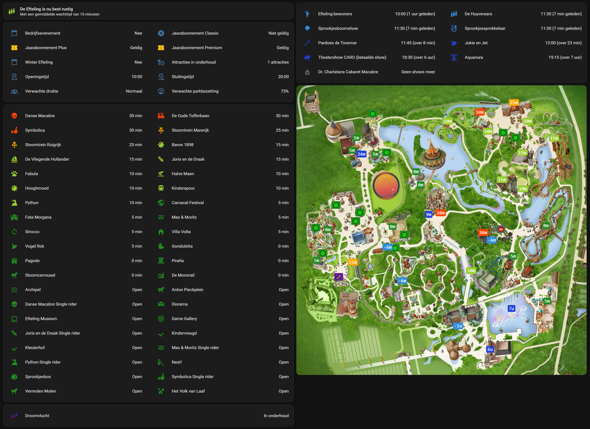

# [][repository] Efteling for Home Assistant [][efteling]

[![Home Assistant integration][home-assistant-badge]][home-assistant]
[![Marketplace install][marketplace-badge]][install]
[![Latest release][version-badge]][version]
[![Validation][validation-badge]][validation]
[![License][license-badge]][license]
[![GitHub stars][stars-badge]][stars]

Bring Efteling's live attraction, show, and park information into Home Assistant with this integration. Build dashboards, receive notifications, and create automations around wait times, opening hours, shows, special events, annual pass validity, and more to make the most of your visit to Efteling!

## Features

- **Attractions** - Live wait times, operating status, images, locations, and attraction details
- **Shows** - Current and upcoming show times, previous show times, status, and show information
- **Park information** - Park status, opening and closing times, and opening-hours schedules
- **Crowd levels** - Live crowd levels based on average attraction wait times, and crowd and occupancy forecasts
- **Events and maintenance** - Winter Efteling, business events, and planned attraction maintenance
- **Annual passes** - Annual pass validity information for Classic, Plus, and Premium
- **Devices and entities** - Dedicated devices, custom icons, and data for dashboards and automations
- **Localization** - Dutch or English information, with translated entity names and states
- **Easy setup** - One-click installation and configuration through the Home Assistant UI

## Dashboard

The screenshot below shows an example of a dashboard built with this integration. You can also use the data in your own cards, scripts, notifications, and automations.



<!-- ha-marketplace:exclude-start -->

## Installation

### One-click installation

[![Add Efteling to Home Assistant][install-badge]][install]

### Home Assistant Marketplace (2026.11 and newer)

1. Open **Settings → Marketplace** in Home Assistant.
2. Search for **Efteling**.
3. Select **Efteling** to open its integration page.
4. Select **Install**.
5. Follow the configuration flow and complete the setup.

The Marketplace installs the integration and starts its configuration flow automatically. No restart is required.

### HACS (older Home Assistant versions)

1. Open **HACS → Integrations**.
2. Select **Explore & Download Repositories**.
3. Search for **Efteling** and open the integration.
4. Select **Download**.
5. Restart Home Assistant.
6. Go to **Settings → Devices & services → Add integration** and search for **Efteling**.

<details>
<summary>Manual installation without the Marketplace or HACS</summary>

1. Download the `custom_components/efteling_park/` directory from this repository.
2. Copy it into the `custom_components/` directory of your Home Assistant configuration.
3. Restart Home Assistant.

</details>

<!-- ha-marketplace:exclude-end -->

## Configuration

### One-click configuration

[![Open the Efteling config flow in Home Assistant][configure-badge]][configure]

### Manual configuration

The integration is configured through the Home Assistant UI. No account credentials or additional settings are required.

1. Go to **Settings → Devices & services → Add integration**.
2. Search for **Efteling**.
3. Select the language for information retrieved from Efteling: **Dutch** or **English**. Dutch is the default.
4. Complete the setup.

The integration creates three devices: **Efteling park**, **Efteling attractions**, and **Efteling shows**.

## Entities

The integration supports Efteling's public attraction, show, park-information, and annual-pass data.
Attraction and show entities are created from the live points-of-interest and wait-time feeds.
Park entities share the Efteling park device. The integration is read-only and does not access personal account information.

### Park

The Efteling park device includes the following entities:

| Entity                        | Description                                                        |
| ----------------------------- | ------------------------------------------------------------------ |
| Park status                   | Whether the park is currently `Open` or `Closed`.                  |
| Attractions under maintenance | Number of attractions listed as being under maintenance today.     |
| Average wait time             | Average live wait time, in minutes, for open attractions.          |
| Crowd level                   | A level calculated from the average live wait time.                |
| Opening time                  | The park's opening time today.                                     |
| Closing time                  | The park's closing time today.                                     |
| Crowd forecast                | Efteling's crowd forecast for today: `Quiet`, `Normal`, or `Busy`. |
| Occupancy forecast            | Efteling's forecast park occupancy percentage for today.           |
| Business event                | Whether a business event is scheduled for today.                   |
| Winter Efteling               | Whether Winter Efteling is active today.                           |
| Annual pass Classic           | Whether a Classic annual pass is valid for entry today.            |
| Annual pass Plus              | Whether a Plus annual pass is valid for entry today.               |
| Annual pass Premium           | Whether a Premium annual pass is valid for entry today.            |

Most entities expose additional attributes, including operating schedules, forecasts, event schedules, validity schedules, and upcoming maintenance information.

**Crowd forecast** and **crowd level** are different measurements. The forecast comes from Efteling's park information, while the integration calculates the crowd level from current attraction wait times. The average only includes attractions reported as open with a valid wait time.

### Attractions

Each attraction has a sensor whose value represents the current wait time in minutes. When an attraction is not open or no valid wait time is available, the sensor state is `unknown`.

For example:

```text
sensor.efteling_attractions_python
State: 20 min
```

Attraction sensors expose additional attributes for dashboards and automations:

| Attribute               | Description                      |
| ----------------------- | -------------------------------- |
| `status`                | Current attraction status.       |
| `empire`                | Efteling area or realm.          |
| `description`           | Attraction description.          |
| `subtitle`              | Attraction subtitle.             |
| `latitude`, `longitude` | Attraction coordinates.          |
| `image`, `image_detail` | Main and detail image URLs.      |
| `properties`            | Attraction properties.           |
| `entry_requirements`    | Entry requirements.              |
| `stimuli`               | Known sensory stimuli.           |
| `targetgroups`          | Target audiences.                |
| `type`                  | Efteling point-of-interest type. |

The attraction status is one of `Open`, `Closed`, `Under maintenance`, `Out of order`, or `Temporarily out of order`. Status labels follow the Home Assistant language setting.

## Use cases

- Show today's opening hours, crowd forecast, and attraction wait times on a visit-planning dashboard.
- Notify household members when an attraction's wait time falls below a chosen threshold.
- Use the park status and business-event sensors in automations while the park is closed or reserved.

For example, notify when Python's wait time is 15 minutes or less:

```yaml
automation:
  - alias: Notify when Python has a short wait
    triggers:
      - trigger: numeric_state
        entity_id: sensor.efteling_attractions_python
        below: 16
    actions:
      - action: notify.mobile_app_phone
        data:
          message: Python's wait time is {{ states('sensor.efteling_attractions_python') }} minutes.
```

### Shows

Each show has a timestamp sensor that provides the start time of the currently running show or, if no show is running, the next upcoming show. If no current or upcoming show is available, the sensor state is `unknown`.

For example:

```text
sensor.efteling_aquanura
State: 2026-10-21 21:00:00
```

Show sensors also expose the following attributes:

| Attribute               | Description                             |
| ----------------------- | --------------------------------------- |
| `status`                | Current show status.                    |
| `current_show_end`      | End time of the currently running show. |
| `previous_showtimes`    | Start times of previous shows.          |
| `upcoming_showtimes`    | Start times of upcoming shows.          |
| `duration_minutes`      | Show duration, in minutes.              |
| `edition`               | Show edition, when available.           |
| `empire`                | Efteling area or realm.                 |
| `description`           | Show description.                       |
| `subtitle`              | Show subtitle, when available.          |
| `latitude`, `longitude` | Show coordinates.                       |
| `image`, `image_detail` | Main and detail image URLs.             |
| `properties`            | Show properties.                        |
| `type`                  | Efteling point-of-interest type.        |

The show status is one of `Currently running`, `Upcoming`, or `No more shows today`. Status labels follow the Home Assistant language setting.

## Update intervals

The integration retrieves all data from Efteling's public cloud endpoints using polling.
It refreshes feeds at the intervals below.

| Data                                     | Refresh interval    | Examples                                                                      |
| ---------------------------------------- | ------------------- | ----------------------------------------------------------------------------- |
| Attraction wait times and show schedules | Every **5 minutes** | Wait times, show start and end times, and show status                         |
| Attraction and show metadata             | Every **24 hours**  | Names, descriptions, images, locations, and visitor information               |
| Park schedule information                | Every **24 hours**  | Opening hours, crowd and occupancy forecasts, events, and planned maintenance |
| Annual passes                            | Every **24 hours**  | Classic, Plus, and Premium validity by date                                   |

Time-sensitive entity states are also updated at relevant times, such as park opening and closing, local midnight, and show transitions, rather than relying solely on the next scheduled data refresh.

## Known limitations

- Data availability and accuracy depend on Efteling's public endpoints and can change without notice.
- Attraction and show entities are available only while those items appear in upstream feeds.
- This integration cannot manage tickets, reservations, annual passes, or customer accounts.
- Updates depend on network access and the availability of Efteling's service.

## Troubleshooting

- **Entities are unavailable:** Check Home Assistant's logs and confirm the host can reach Efteling's public service. Home Assistant retries temporary endpoint failures automatically.
- **An attraction or show is missing:** It must appear in the relevant Efteling feeds.
  Reload the integration after confirming the upstream listing has returned.
- **Names or descriptions use the wrong language:** Reconfigure the integration, choose Dutch or English, and allow the entry to reload.
- **Schedules are incomplete:** Efteling controls the available date range and schedule content; the integration cannot supply dates that the endpoint has not published.

## Removal

1. Open **Settings → Devices & services** in Home Assistant.
2. Select the **Efteling** integration.
3. Open the integration menu and select **Delete**.
4. Confirm removal.

To also remove the integration files:

- **Marketplace:** Uninstall Efteling from **Settings → Marketplace**.
- **HACS:** Uninstall Efteling from **HACS → Integrations**.
- **Manual installation:** Remove `custom_components/efteling_park/` from your Home Assistant configuration and restart Home Assistant.

## Development

The integration's source code is located in `custom_components/efteling_park/`. You can use the Home Assistant development container to work on the integration. Run `scripts/setup` and `scripts/develop` to set up and launch a local Home Assistant environment.

## Credits

Efteling for Home Assistant is a community-developed custom integration that retrieves information published by Efteling. This project is independent and is not affiliated with or endorsed by Efteling.

Efteling and all associated trademarks, names, images, and services remain the property of their respective owners.

[repository]: https://github.com/dkempen/ha-efteling
[efteling]: https://www.efteling.com
[home-assistant]: https://www.home-assistant.io
[home-assistant-badge]: https://img.shields.io/badge/Home_Assistant-Integration-18bcf2.svg?logo=homeassistant&logoColor=white
[marketplace-badge]: https://img.shields.io/badge/Marketplace-Default-18bcf2.svg?logo=homeassistant&logoColor=white
[version]: https://github.com/dkempen/ha-efteling/releases
[version-badge]: https://img.shields.io/github/v/release/dkempen/ha-efteling?label=Version
[stars]: https://github.com/dkempen/ha-efteling
[stars-badge]: https://img.shields.io/github/stars/dkempen/ha-efteling
[validation]: https://github.com/dkempen/ha-efteling/actions/workflows/hassfest.yaml
[validation-badge]: https://img.shields.io/github/actions/workflow/status/dkempen/ha-efteling/hassfest.yaml?logo=github&logoColor=fff&label=Validation
[license]: https://github.com/dkempen/ha-efteling?tab=MIT-1-ov-file
[license-badge]: https://img.shields.io/github/license/dkempen/ha-efteling?label=License
[install]: https://my.home-assistant.io/redirect/hacs_repository/?owner=dkempen&repository=ha-efteling
[install-badge]: https://my.home-assistant.io/badges/hacs_repository.svg
[configure]: https://my.home-assistant.io/redirect/config_flow_start/?domain=efteling_park
[configure-badge]: https://my.home-assistant.io/badges/config_flow_start.svg
